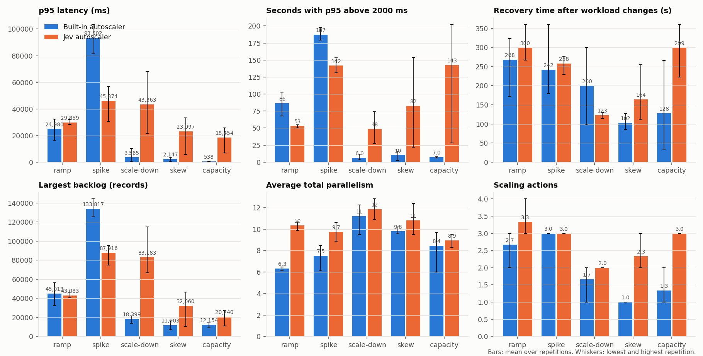
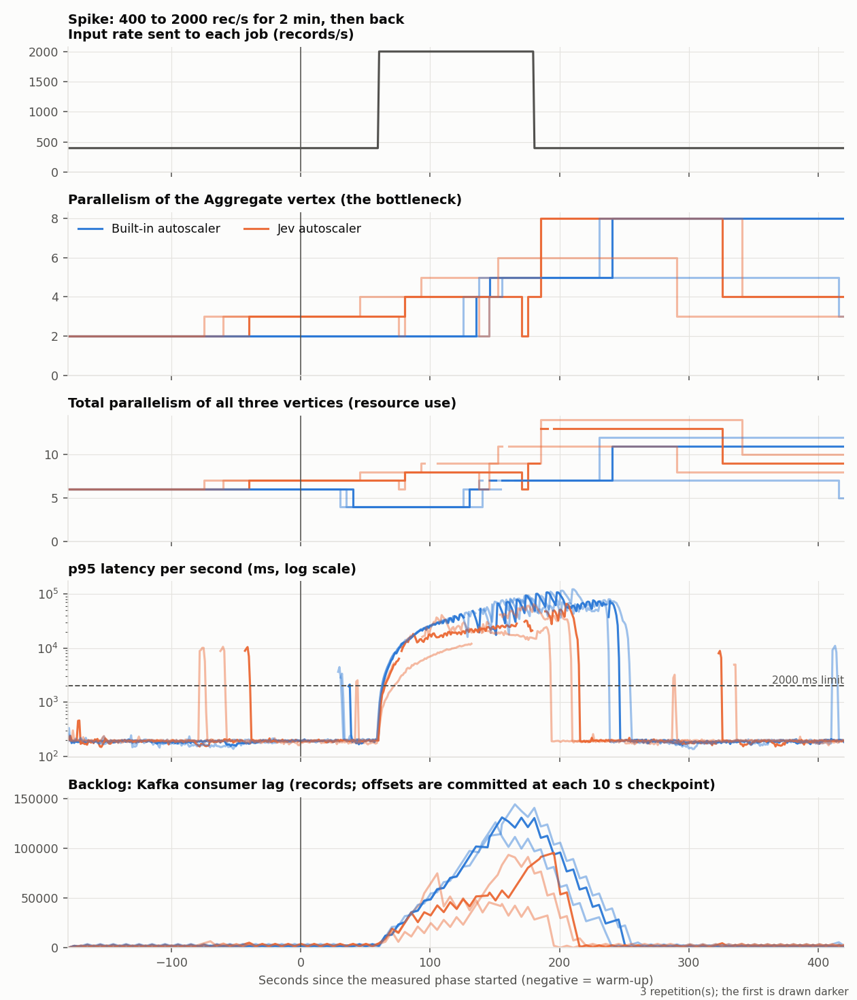
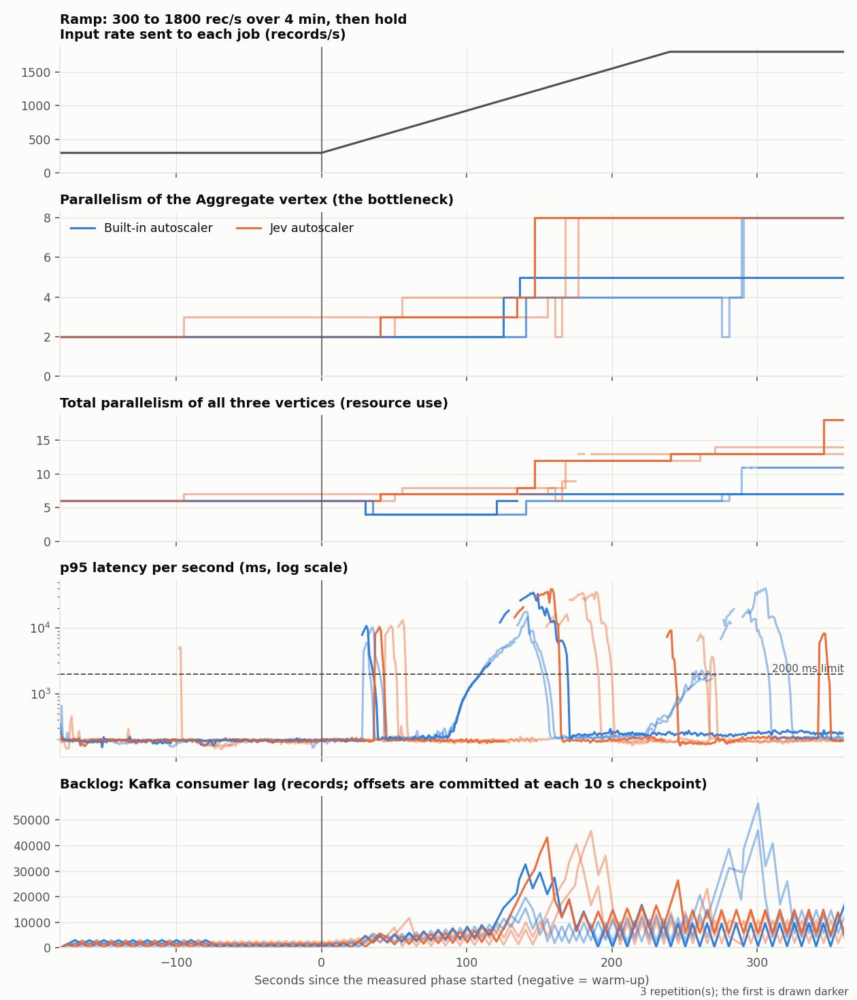
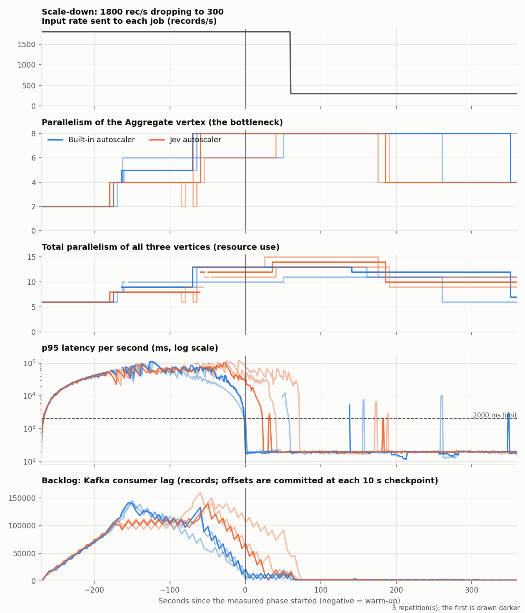
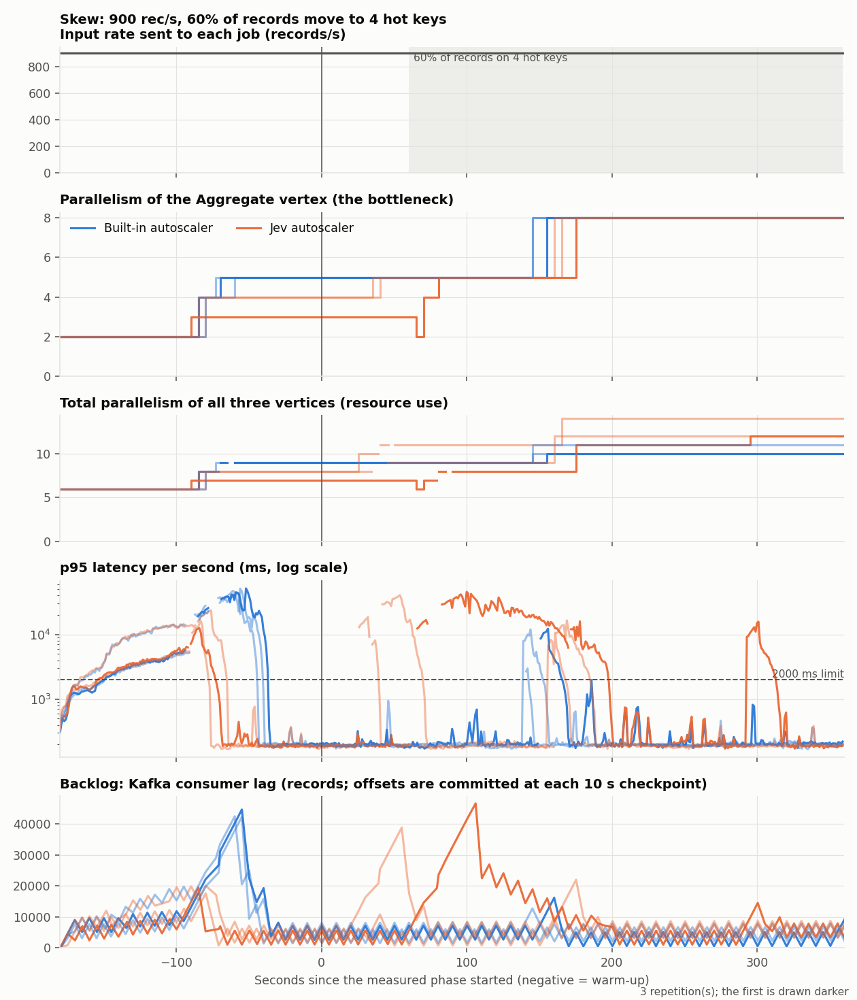
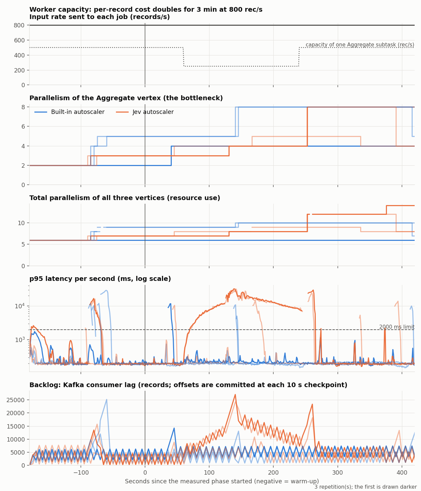
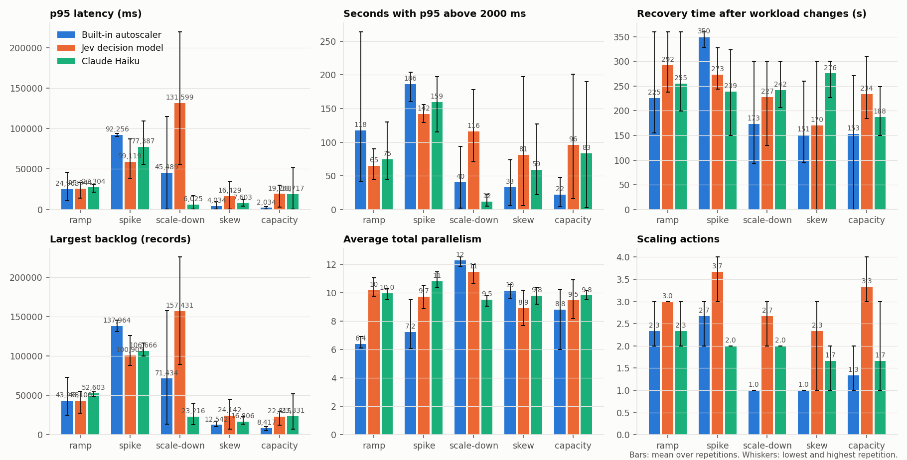

> **Superseded (2026-11-17).** Everything in this file describes the pilot runs of the first version of
> the plugin and benchmark. Those runs are not valid for comparing controllers: the built-in rule and the
> plugin used different effective settings (ISSUES.md #16, #17), the true backlog was measured against
> stale positions (#28), and the built-in rule restarted its job shortly before each scenario began
> (#31). The current results are in [FINDINGS.md](FINDINGS.md).
>
> An audit on 2026-11-19 (`paper/reviews/audit3/numbers_audit.md`) compared this text with the pilot's own
> data. Four statements were corrected in place (slots per pod, mean call latency, cost per call, the
> status of Issues #10 and #11). Four others are left as written and do not match the data, according to
> the audit:
> - "Throughput matched the input rate ... in every scenario": processed over sent was 1.02 to 1.08, and
>   1.34 for Jev in the scale-down scenario.
> - "Jev had settled at 3–4 ... the built-in sat at 5 ... two scaling rounds to reach 8": Jev was at 3, 5, 5
>   and 3, 4, 3 before the disturbance and the built-in at 5, 5, 5 and 4, 5, 5; two rounds to 8 in 3 of
>   6 runs, one round in 2, and 8 was not reached in 1.
> - "every model that answered kept 4" (skew case): Sonnet at medium effort answered 8 in 3 of 4 answers.
> - "Only the spike, skew and capacity differences are consistent across all repetitions": the ramp's
>   seconds over the limit and the scale-down reaction time were consistent too.

# Findings: Jev autoscaler vs. the built-in autoscaler

15 runs: 5 scenarios × 3 repetitions. In every run both jobs received the same records at the same
time. Full tables are in [results/summary.md](results/summary.md), raw data in `results/<scenario>/rep<k>/`.

## Verdict

**Jev did not beat the built-in autoscaler overall.** It was clearly better on the spike, mixed on
the ramp, and worse on skew and on the worker-capacity change. It used more parallelism in every
scenario and restarted the job more often. The plugin itself worked reliably: 193 model calls,
0 failures, 0 fallbacks, and the model costs well under one cent per job-hour.

## Results per scenario

Means over 3 repetitions; the range of the repetitions is in brackets.

| Scenario | Metric | Built-in | Jev | Better |
|---|---|---|---|---|
| **spike** | p95 latency | 93.5 s (81.8–103) | 45.9 s (30.6–56.7) | Jev |
| | seconds with p95 > 2 s | 187 | 142 | Jev |
| | largest backlog | 133,817 | 87,916 | Jev |
| | average total parallelism | 7.5 | 9.7 | built-in |
| **ramp** | p95 latency | 25.0 s (16.4–32.2) | 29.9 s (28.4–32.2) | about equal |
| | seconds with p95 > 2 s | 86 (68–103) | 53 (50–55) | Jev |
| | average total parallelism | 6.3 | 10.3 | built-in |
| **scale_down** | first scale-down after the drop | 201 s, 291 s, never in window | 116 s, 126 s, 131 s | Jev |
| | p95 latency | 3.6 s | 43.4 s | not comparable, see below |
| **skew** | p95 latency | 2.1 s (0.2–3.5) | 23.1 s (5.7–33.2) | built-in |
| | seconds with p95 > 2 s | 10 | 82 | built-in |
| | scaling actions | 1.0 | 2.3 | built-in |
| **capacity** | p95 latency | 0.5 s (0.2–0.7) | 18.5 s (6.8–25.7) | built-in |
| | seconds with p95 > 2 s | 7 | 143 (28–202) | built-in |
| | scaling actions | 1.3 | 3.0 | built-in |

Throughput matched the input rate for both in every scenario; neither lost records. Average
TaskManager pods were within 0.2 of each other everywhere, because one pod holds 4 slots.

### Spike: Jev scales up sooner

Jev first scaled Aggregate up about 15–20 s after the spike began in two runs (the third had
scaled up just before it); the built-in took 60–80 s. Its backlog peaked a third lower and was
drained 30–40 s earlier. Jev scaled back down afterwards in all three runs; the built-in did so
in one, and in the other two it scaled up to 8 about a minute after the spike had already ended.

### Ramp: Jev keeps up, at a much higher cost

Jev went to 8 subtasks early because it is shown utilization projected two minutes ahead. That cut
the seconds over the latency limit by 40%, but used 60% more parallelism, and p95 over the whole
window was no better because each of its 3–4 restarts adds its own latency blip.

### Scale-down: Jev releases capacity sooner; the latency numbers are contaminated

Jev halved Aggregate about 2 minutes after the drop in all three runs; the built-in took 3.5 to 5
minutes, or did not get there within the window. **The latency and backlog rows for this scenario
should not be used**: the warm-up at 1800 rec/s builds a backlog that Jev was still draining when
the measured window opened (0–70 s into it). From 30 s after the drop, both jobs had the same p95
(about 200 ms).

### Skew and capacity: Jev ran leaner beforehand and paid for it

Before the disturbance, Jev had settled at 3–4 Aggregate subtasks (about 65–70% utilization, "meets
the target"), while the built-in sat at 5. When hot keys or the doubled per-record cost arrived,
Jev had no headroom, went into overload and needed two scaling rounds (about 105 s apart) to reach
8. The built-in needed one round or none.

## Why Jev lost where it lost

1. **Both autoscalers are nearly blind during overload, and Jev has less margin for it.** Under
   backpressure the measured demand of a vertex *falls* (in `capacity` rep 1 it read 660 rec/s
   while 800 rec/s were arriving) and Flink's `pendingRecords` showed a few hundred records while
   Kafka lag was over 20,000. With those inputs "4 subtasks" looked sufficient to Jev (it put 0.53
   on scaling up by one step).
2. **Every scaling action costs a restart**: p95 jumps to 5–10 s for roughly 10 s, and the next
   decision is only possible about 105 s later. Jev made 2.7 actions per run against 1.9, so
   small steps are expensive.
3. **Jev's answers are noisy.** Identical requests return different probabilities. In 8 of 66
   parallelism changes Jev's top choice was actually "keep the current setting", but the summed
   probability of the higher options just crossed the 0.5 threshold, so the plugin scaled up
   vertices that were 23–40% busy (mostly the Measure vertex). This is a defect in my threshold
   rule, logged as Issue #10 (fixed after these runs).
4. **Jev matches descriptions; it does not compute.** All the arithmetic (capacity, utilization,
   drain time, verdict per option) had to be done in code and written into the option text. What
   remains for the model is close to a table lookup, which a rule would do deterministically.

## Three-way run: built-in vs. Jev vs. Claude

A second benchmark ran three jobs side by side on the same records: the built-in autoscaler, the
plugin with Jev, and the plugin with Claude Haiku 5.5 (`provider: anthropic`). Claude gets the raw
measurements and a policy in words; limits, cooldowns and fallback are the same code as for Jev.
All 15 runs are valid (5 scenarios, 3 repetitions). The third repetition of scale-down, skew and
capacity was rerun after the local cluster stopped because the host disk was full (Issue #13).
Full tables:
[results-3way/summary.md](results-3way/summary.md).

p95 latency, mean over repetitions with the range in brackets:

| Scenario | Built-in | Jev | Claude |
|---|---|---|---|
| ramp (3) | 25.0 s (11.0–45.3) | 25.9 s (14.0–33.9) | 27.3 s (21.2–30.7) |
| spike (3) | 92.3 s (90.2–93.6) | 59.1 s (38.9–86.9) | 77.4 s (56.0–109) |
| scale_down (3) | 45.5 s (0.2–115) | 132 s (55.3–219) | 6.0 s (0.2–17.2) |
| skew (3) | 4.0 s (0.3–9.6) | 16.4 s (0.2–34.2) | 7.6 s (4.1–12.0) |
| capacity (3) | 2.0 s (0.3–3.4) | 19.2 s (2.8–30.2) | 18.7 s (0.2–51.5) |

Averages over all 15 runs:

| | Built-in | Jev | Claude |
|---|---|---|---|
| Scaling actions per run | 1.7 | 3.0 | 1.9 |
| Direction reversals per run | 0.13 | 0.53 | 0.13 |
| Average total parallelism | 9.0 | 10.0 | 10.0 |
| Model calls | – | 163 | 212 |
| Model cost per job-hour | – | about $0.006 | about $0.04 |
| Mean call latency | – | 147 ms | 3.7 s |
| Fallbacks | – | 0 | 0 |

- **Claude did not beat the built-in autoscaler overall either.** It was clearly better on
  scale-down, better than the built-in on the spike, about level on the ramp, somewhat worse on
  skew and much worse on capacity (two good runs, one very bad).
- **Claude behaved more like the built-in than Jev did**: about as few scaling actions and
  reversals as the built-in, where Jev made 80% more actions. It still used as much parallelism as
  Jev.
- **Scale-down is Claude's clear win.** It scaled up hard enough during warm-up to enter the
  measured window with little backlog, and averaged 9.5 total parallelism against 12.3 for the
  built-in. In the first two runs it released capacity 50 s after the drop (Jev 130 s; built-in
  306 s or not at all). In the third run all three jobs entered the window with a large backlog
  (Issue #11), which is what moved the built-in and Jev means so far; Claude's p95 was 17 s there.
- **Capacity change is still the weak spot for both models**, consistent with the inputs being
  wrong under backpressure; telling Claude about it in the prompt was not enough.
- **Claude is slow for a control loop.** Two of 212 calls took 13.7 s and 15.3 s, close to the
  15 s reconcile interval. They still returned an answer, so no fallback was triggered.
- **Caveats:** three repetitions with wide, overlapping ranges; three jobs share the
  cluster here, so the built-in and Jev numbers differ from the two-way run above; Jev's known
  defect (Issue #10) was still present in these runs.

## Model cost and latency

| | |
|---|---|
| Calls | 193 over 15 runs, about 13 per 7-minute run (no call during cooldowns) |
| Input tokens | 403,231 in total, about 2,100 per call |
| Cost | $0.017 for the whole benchmark; about $0.007 per job-hour, roughly $5 per job-month |
| Call latency | median 109 ms, p95 214 ms, slowest 1.8 s |
| Failures | 0 errors, 0 retries exhausted, 0 fallbacks, circuit breaker never opened |

The fallback path (timeout, HTTP error, missing key, open circuit) is therefore only covered by
unit tests and by the DNS problem during development (Issue #1), not by the benchmark.

## Offline check: can the models reproduce the built-in formula?

Separate from the cluster benchmark. Eleven fixed cases (60% target, limits 1–8, 60 s catch-up) were
put to each model with the built-in rule written out in words and only the raw measurements; the
reference answer is the formula computed in code. Jev was asked 10 times per case, the Claude models
5 times, at medium effort. Full table: [results/model_eval/summary.md](results/model_eval/summary.md);
script: `bench/model_eval.py`.

| Model | Exact (10 scored cases) | Too low | Too high | Median latency | Cost per decision |
|---|---|---|---|---|---|
| Jev, raw inputs | 39 of 100 | 51 | 10 | 214 ms | $0.00003 |
| Jev, options computed in code (as the plugin does) | 100 of 100 | 0 | 0 | 189 ms | $0.00003 |
| Claude Haiku 5.5 | 50 of 50 | 0 | 0 | 1.5 s | $0.00015 |
| Claude Sonnet 5.5 | 25 of 50 | 0 | 24 | 1.6 s | $0.0046 |
| Claude Sonnet 5.5, high effort | 30 of 50 | 0 | 19 | 2.0 s | $0.0049 |
| Claude Opus 5.5 | 50 of 50 | 0 | 0 | 2.0 s | $0.0042 |
| Claude Fable 5.2 | 50 of 50 | 0 | 0 | 2.4 s | $0.0061 |

- **Jev cannot apply the formula itself.** From raw inputs it gets the direction right but not the
  size (2→3 where 5 is needed; no change when capacity halves), and half its answers leave the
  vertex above target. It is only correct when the code has already computed every option, at which
  point the code has the answer and Jev is reading it back.
- **Haiku, Opus and Fable matched the formula on every call**, including the 900 vs. 901 rec/s
  rounding boundary. Haiku does so at about 5× Jev's cost and 7× its latency, which is still well
  inside a 15 s autoscaler cycle.
- **Sonnet was unreliable in this test**: half its answers were too high (never too low), and 3 of
  110 calls ran out of output tokens. In an earlier format where it wrote out its calculation, the
  calculation was correct each time, so this looks sensitive to the answer format (Issue #12).
- **Skew** (one subtask 100% busy, average 55%): every model that answered kept 4, like the formula.
  In an earlier run that allowed a one-sentence reason, Opus and Fable added that this is data skew
  which more parallelism would not fix; Jev cannot say anything like that.
- These cases have clean inputs. They show whether a model can do the sizing, not whether it would
  beat the formula on a live job where the inputs themselves are wrong (see "Why Jev lost").

## Limits of this comparison

- **Three repetitions**, and the ranges overlap in several rows (ramp p95, recovery times). Only
  the spike, skew and capacity differences are consistent across all repetitions.
- **The prompt was tuned during development** against the spike, ramp and scale-down scenarios
  (Issues #3 and #4). Skew and capacity were not used for tuning, and those are the two Jev lost.
  The built-in autoscaler was not tuned beyond the shared settings.
- **Short windows**: 1-minute metric window and 30 s stabilization instead of the production
  defaults (15 and 5 minutes). Longer windows would reduce noise for both.
- **Cooldowns differ**: the built-in uses a 2-minute scale-down interval; Jev blocks all scaling
  for 45 s and scale-downs for 150 s after any action.
- **Simulated work**: per-record cost is a timed park, so CPU contention, GC and state size
  effects are absent. One laptop, one Kafka broker, one TaskManager pod size.
- **Recovery time** is capped at the window length, so 360 means "did not recover in the window".
- **Warm-up for `scale_down` was too short** in these runs (Issue #11, fixed since), as described above.

## What I would do next

1. Fix Issue #10: only scale when Jev's top choice itself is a change, then rerun. (Done.)
2. Give both autoscalers Kafka consumer lag instead of `pendingRecords` as the backlog signal.
3. Make Jev's target include headroom (for example 55–60% utilization) or cap it to one scale-up
   per event by offering only "enough for the worst recent minute".
4. Lengthen the `scale_down` warm-up until both jobs have drained, and run 5+ repetitions.

On this evidence, Jev is a workable but not a better decision-maker for this job: its one clear
win (faster reaction to a spike) came with 30% more parallelism, and a built-in autoscaler with a
lower utilization target would likely get the same effect without a model call.
